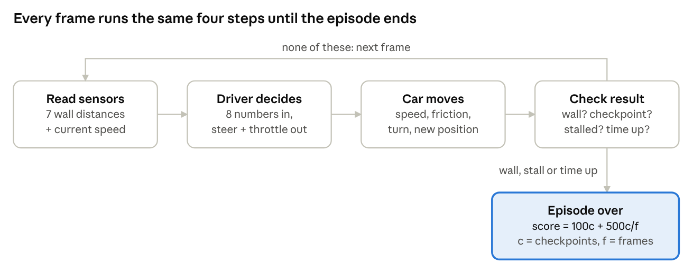
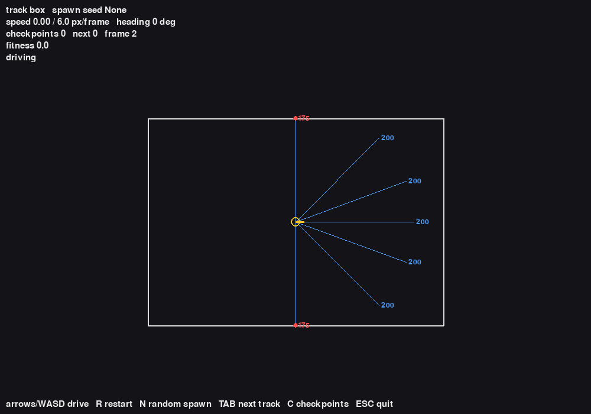
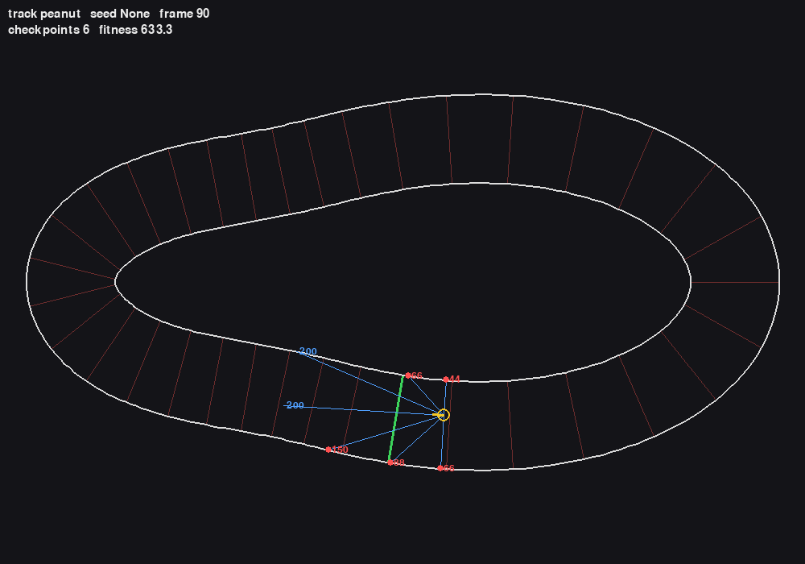
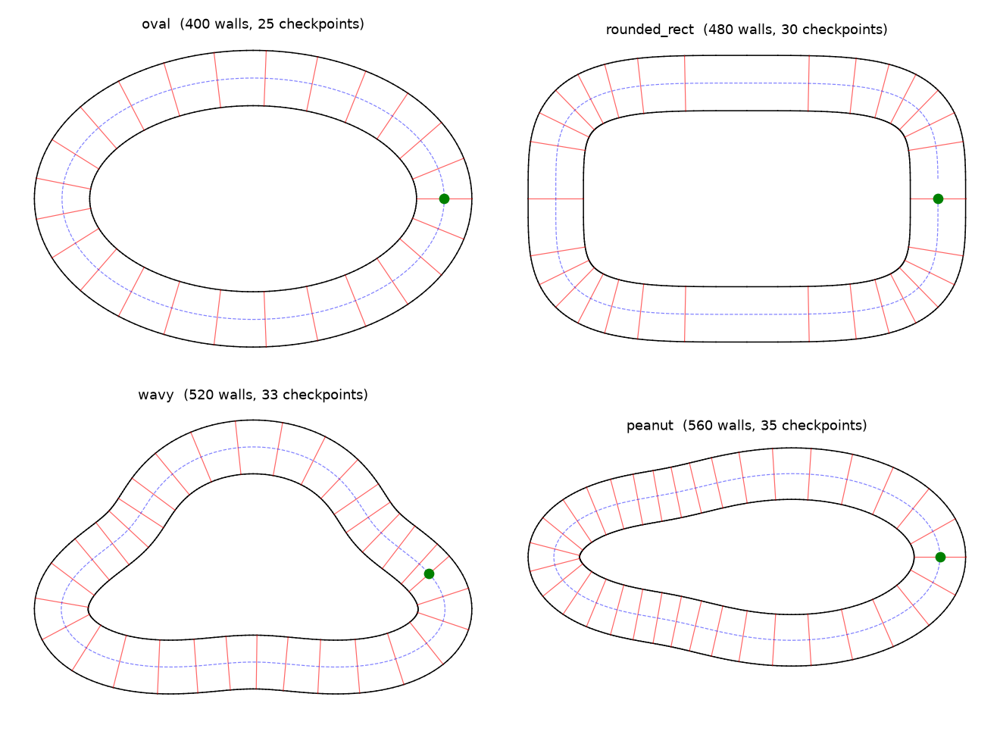
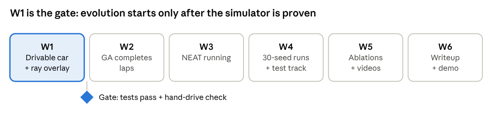

# Evo-Racer: Project Notes

Oct 12, 2026 · @Arshan M · Live version: [Claude Doc](https://claude.ai/code/artifact/d015a8ea-dd39-4e34-bcd3-8054c70f60b8)

## The project in one minute

We evolve a neural-network driver for a 2D race car instead of programming it. We train on 3 tracks, test on a 4th it has never seen, and measure the score drop: the **generalization gap**. Two methods: a genetic algorithm (DEAP) and NEAT.

## Key terms

| Term | Meaning |
| --- | --- |
| Frame | One tick of the simulation |
| Episode | One drive, until a crash, stall or time-out |
| Sensor (raycast) | Distance to the nearest wall in one direction; 7 per car |
| Checkpoint | A line across the track; crossing them in order = progress |
| Genome | The 90 network weights that define one driver |
| Fitness | A driver's score; higher is better |
| Generation | One round: score every driver, keep the best, breed new ones |
| Generalization gap | Training score minus score on the unseen track |

## W1: build the world before evolving anything

Goal: a car we can drive by hand, with its sensors drawn on screen. No evolution code until this works, because a buggy simulator looks exactly like a failing algorithm.

Status: built, 18 tests pass. Remaining: a hand-drive check.

## What we built in W1

Each frame runs one loop:



| Part | What it does |
| --- | --- |
| Tracks | 4 loops built from math formulas; walls are short line pieces |
| Physics | Gas, brake, friction; turns only while moving; top speed 6 px/frame |
| Sensors | 7 rays from −90° to +90°, range 200 px, scaled to 0–1 |
| Spatial grid | Each ray checks only nearby walls, not all \~500 |
| Collision | The car is an 8 px circle; touching a wall ends the run |
| Checkpoints | 25–35 per lap; only the next one, crossed forward, counts |
| Debug window | Drive with arrow keys; rays and distances drawn live |

Score (c = checkpoints passed, f = frames survived):

```math
\text{fitness} = 100\,c + 500\,\frac{c}{f}
```

Progress counts most; the second term is a small speed bonus. An episode ends on a wall hit, 150 frames without a new checkpoint, or 1000 frames total.

**Debug window:** blue rays show distances, red dots are wall hits. Top: the test box (side walls 175 px away, as calculated). Bottom: the demo driver on the test track.





## Decisions we made, and why

| Decision | Choice | Why |
| --- | --- | --- |
| Test track | Redesigned `peanut` with a sharper turn | The old one was the easiest track, so the test meant nothing |
| Start position | Seed picks a random checkpoint; same for every driver in a generation | Fair race; no memorizing one start |
| Combining tracks | Average of the 3 scores | Simple; smooth early progress |
| Turning | Turn rate stops growing above 2 px/frame | Faster = wider turns, so braking matters |
| Checkpoints | Forward crossings only | No farming points by going back and forth |

The test track has the sharpest turn (smaller radius = sharper):

| Track | Role | Checkpoints per lap | Tightest turn (px) |
| --- | --- | --- | --- |
| `oval` | Train | 25 | 152 |
| `rounded_rect` | Train | 30 | 106 |
| `wavy` | Train | 33 | 75 |
| `peanut` | Test | 35 | 66 |



Red lines: checkpoints. Green dot: start. Bottom right: the test track.

## How we know it works

- **18 automated tests pass.** Sensor distances match hand calculations, and the fast grid gives the same answers as checking every wall.
- **5 planted bugs, all caught.** We broke the code on purpose to prove the tests notice.
- **Demo driver laps every track.** A simple steer-toward-open-space rule did about 3 laps on all four tracks without crashing.
- **Fast enough.** About 36 µs per frame, which fits the 10-minute target for 100 generations once runs are parallel.

## Questions students might ask

**Why not just program the driver?** We did, as a baseline. The question is whether evolution finds one that works on new tracks.

**Why not Gymnasium's CarRacing?** It feeds camera images, which need a much bigger network. Seven distances are enough.

**Why not reward distance traveled?** Driving in circles racks up distance. Ordered checkpoints only reward real progress.

**Why is the test track harder?** An easier test passes everything and tells us nothing.

**Why give every driver the same seed?** Same start = fair race. Changing it each generation stops drivers memorizing one spot.

**Why stop after 150 frames without a checkpoint?** A stopped or circling car would waste compute.

**Can a fast car glitch through a wall?** No. It moves at most 6 px per frame and is 16 px wide, so it always touches the wall first.

## What's next, and known gaps

Next (W2): evolve the 90 weights with a genetic algorithm until a driver completes laps.



Open gaps:

- All tracks run clockwise, so a right-turn habit transfers for free.
- The hand-coded baseline already laps every track: a high bar to beat.
- About 330 runs ≈ 27 hours of compute; ablations may need fewer seeds.
- NEAT (W3) still needs a config file and a shared-seed evaluator.
